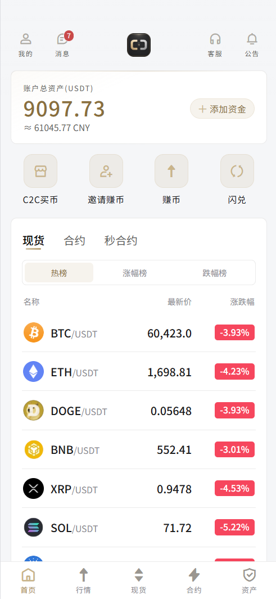
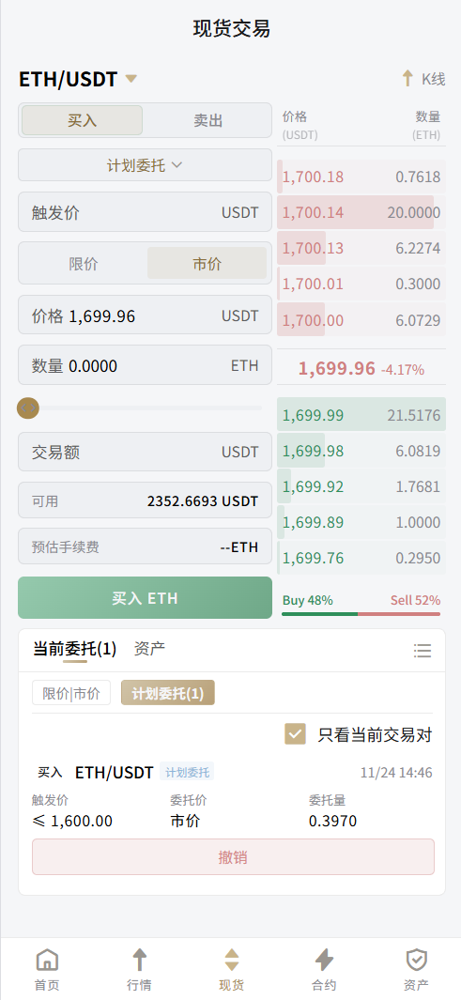
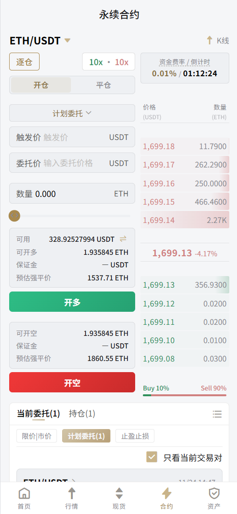
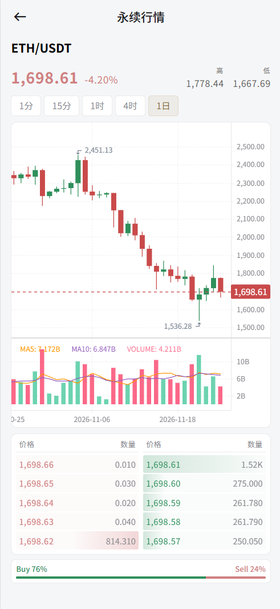
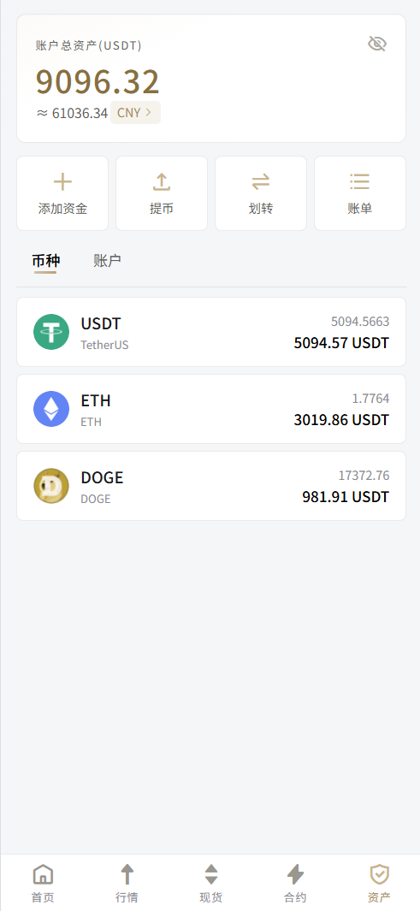
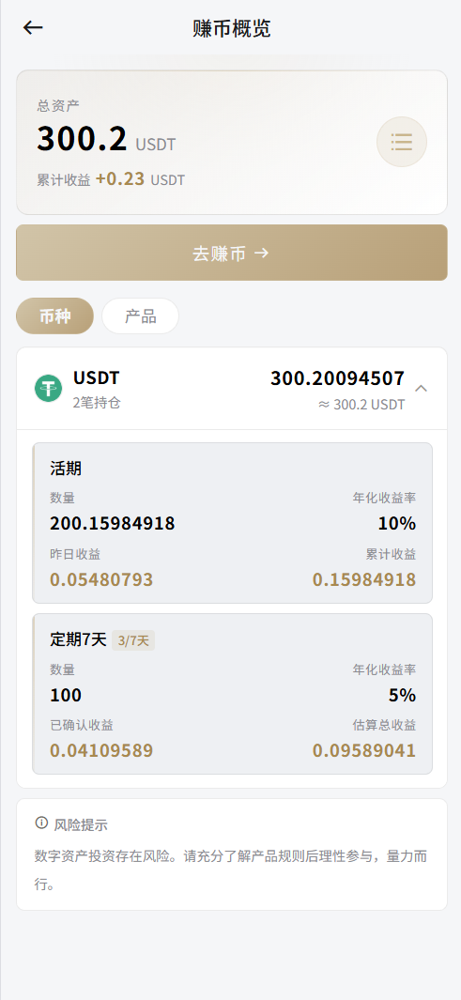
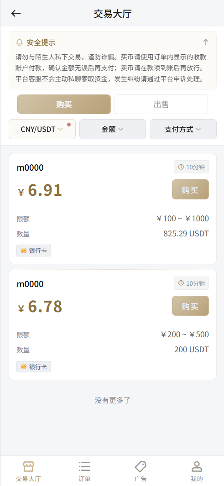
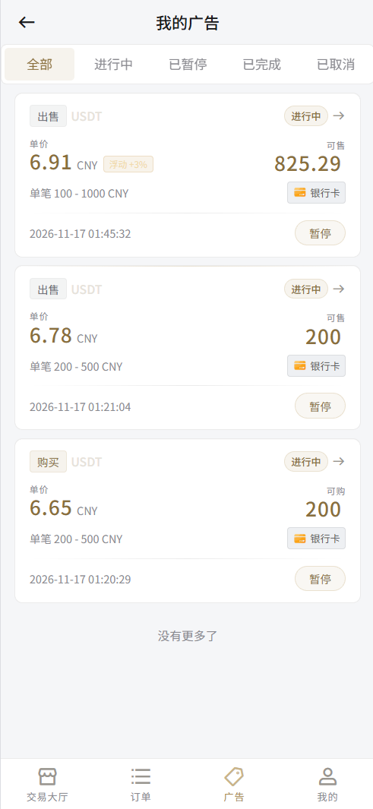

**基于 Spring Boot + Vue3 的一站式数字货币交易所解决方案**

[简体中文](README.md) | [English](README_EN.md)

## 项目简介

`exchange` 是一套**完整的中心化数字货币交易所系统**，覆盖用户端（uni-app 多端 H5）、运营管理后台（Vue3 + Vite）与后端服务（Spring Boot）。支持现货、C2C、秒合约、永续合约、理财、充提币、闪兑、返佣、会员与安全、平台运营等十余个业务域，具备完整的撮合、计息、风控与后台运营能力。

本仓库展示部分代码，完整源码、部署方案及定制开发请通过文末「联系我们」获取。

## 在线演示

> 演示环境仅供功能体验，数据可能定期重置，请勿用于真实资产操作。

| 端 | 地址 | 账号 | 密码 |
|---|---|---|---|
| 用户端 H5 | [http://45.133.239.144:8082/#/subPages/auth/login](http://45.133.239.144:8082/#/subPages/auth/login) | 13100000000 | 123456 |
| 运营后台 | [http://45.133.239.144:8083/login](http://45.133.239.144:8083/login) | admin | 123 |
| Android App | [http://45.133.239.144:8082/android.apk](http://45.133.239.144:8082/android.apk) | 13100000000 | 123456 |

## 功能特性

- **多端覆盖**：uni-app 用户端（H5 / 小程序 / App）+ Vue3 运营管理后台。
- **现货交易**：限价 / 市价、计划委托、盘口深度、K 线联动。
- **C2C 交易**：交易大厅、挂单广告、买卖订单、申诉与聊天、商家管理。
- **秒合约**：按周期开仓/平仓、赔率配置、到期自动结算与补偿任务。
- **永续合约**：逐仓杠杆、资金费率、强平检查、计划委托撮合。
- **理财**：活期 / 定期产品、申购赎回、收益计提与明细。
- **资产管理**：充币 / 提币、内部划转、账单流水、USDT 折算。
- **闪兑**：币种间快速兑换与订单记录。
- **邀请返佣**：多级团队、返佣记录与配置。
- **会员与安全**：注册登录、实名认证、谷歌验证器、资金密码、登录设备与安全设置、站内信通知。
- **运营后台**：70+ 管理页面，覆盖用户、订单、资产、风控、参数配置与统计看板。
- **国际化**：简体中文 / 繁体中文 / English。

## 技术栈

| 层级 | 技术 | 说明 |
|---|---|---|
| 用户端 | uni-app、Vue 3、Vite、Wot UI、UnoCSS、Pinia、Alova、vue-i18n、klinecharts | H5 / 小程序 / App 多端 |
| 管理端 | Vue 3、TypeScript、Vite、TDesign Vue Next、Pinia、Axios、ECharts | 运营管理后台 |
| 后端框架 | Spring Boot 2.4.5、Java 8、Spring Data JPA、Hibernate | 单体分层架构 |
| 安全与并发 | Sa-Token、Redis、Redisson（分布式锁 @Lock、Topic 消息） | 登录鉴权 / 会话 / 并发控制 |
| 数据存储 | MySQL、Redis | 业务数据 + 缓存 |
| 定时任务 | Spring @Scheduled（12 线程池） | 22 个后台 Job：撮合、强平、计息、行情同步、数据折算与清理等 |
| 行情数据 | OkHttp REST + WebSocket（订阅 OKX 公共频道） | K 线与盘口行情同步 |
| 工具库 | Hutool、EasyExcel、Lombok、javax.mail | 通用能力 |
| 构建 / 部署 | Maven、Vite、Nginx | 前后端分离部署 |

## 页面展示

### 用户端

<table>
  <tr>
    <td align="center"></td>
    <td align="center"></td>
    <td align="center"></td>
    <td align="center"></td>
  </tr>
  <tr>
    <td align="center"></td>
    <td align="center"></td>
    <td align="center"></td>
    <td align="center"></td>
  </tr>
</table>

## 联系我们

如需完整源码、部署方案或定制开发，可通过以下方式联系：

Telegram： [muyu8848](https://t.me/muyu8848)

## License

本项目开源部分采用 [MIT License](LICENSE)。完整生产级源码的授权与使用另行约定。

---

> ⚠️ **免责声明**
>
> 本项目仅供**学习研究与技术交流**，不构成任何投资建议或金融服务承诺。
>
> - 本项目不用于、也不支持未经许可的真实金融业务运营，请勿用于承载真实资金。
> - 数字资产及杠杆/合约交易风险极高，任何上线、运营、推广行为及相应合规责任由使用方自行承担。
> - 本项目按「现状」提供，不对可用性、稳定性、安全性及收益作任何明示或默示担保。
> - 若涉及用户数据采集与处理，请使用方自行满足所在地区法律法规及隐私合规要求。
> - 本项目为参考主流交易所交互风格的实现，与任何官方交易所无合作或授权关系。
