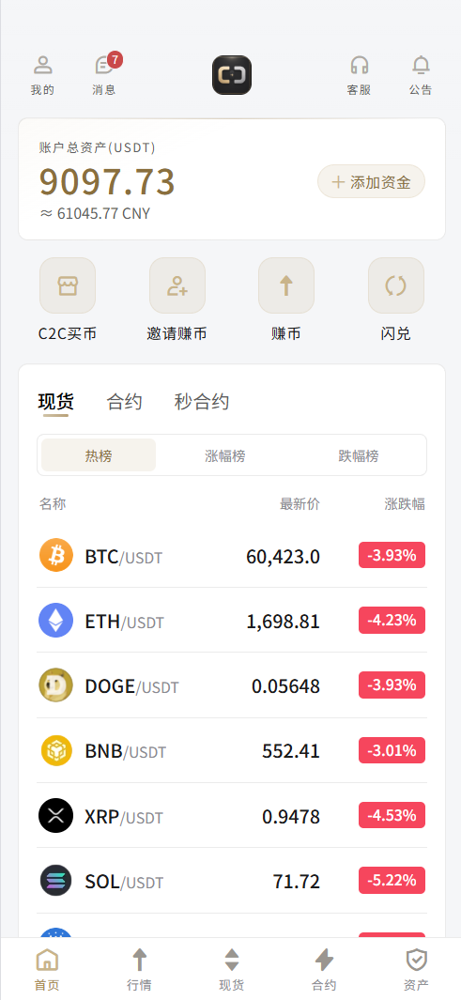
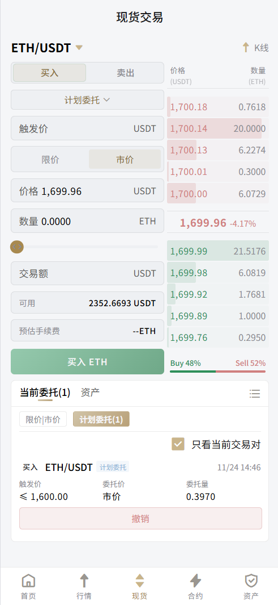
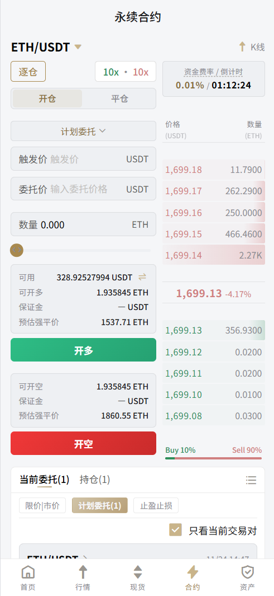
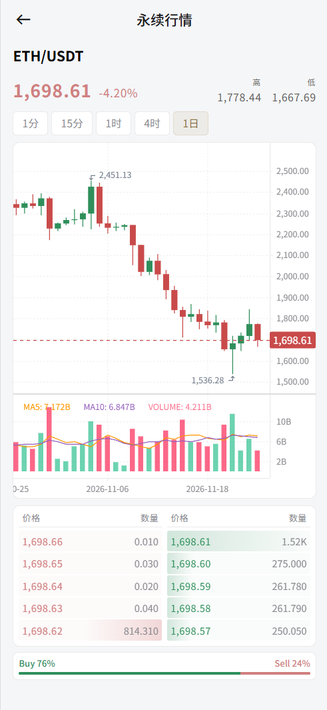
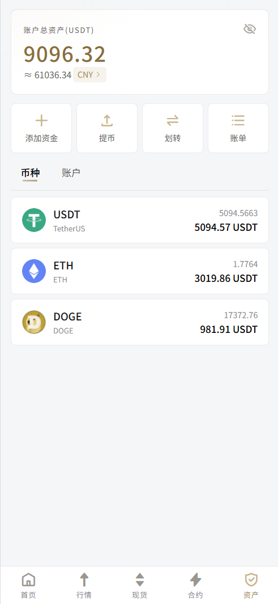
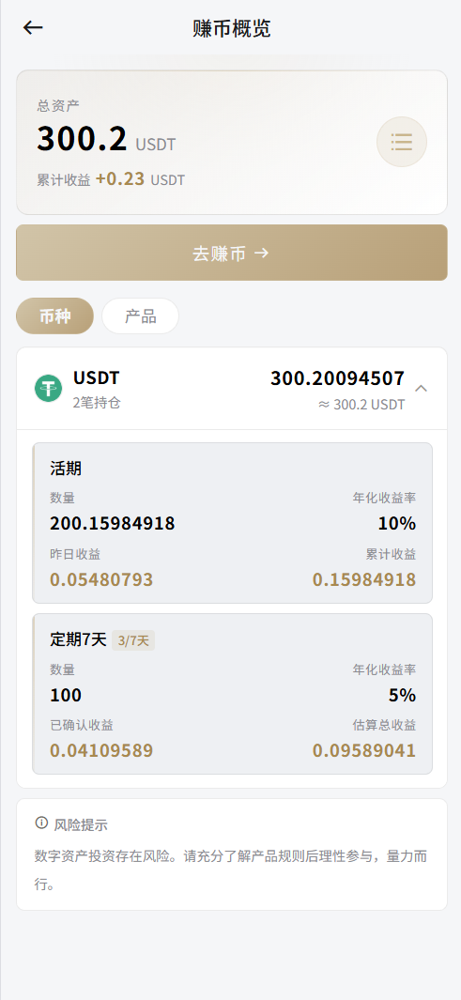
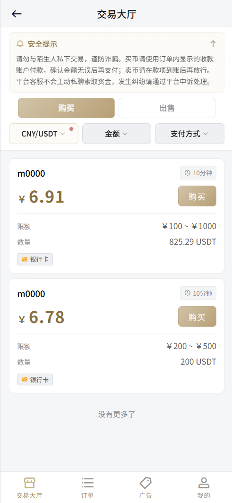
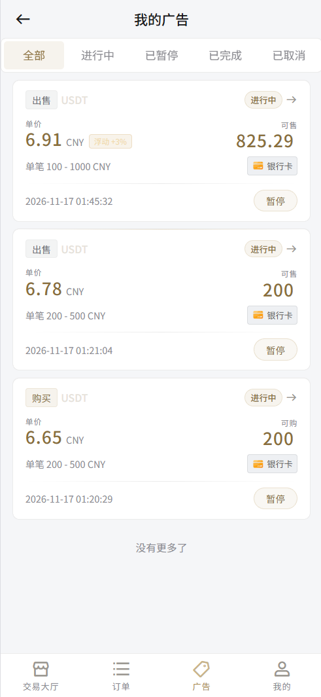

**An All-in-One Crypto Exchange Solution Built with Spring Boot + Vue 3**

[简体中文](README.md) | [English](README_EN.md)

## Overview

`exchange` is a **complete centralized cryptocurrency exchange system**, covering the user client (uni-app multi-platform H5), the operations admin panel (Vue 3 + Vite), and backend services (Spring Boot). It supports more than ten business domains including spot trading, C2C, flash contracts, perpetual contracts, wealth management, deposits & withdrawals, instant swap, referral rebates, membership & security, and platform operations, with full capabilities in order matching, interest accrual, risk control, and backend operations.

This repository presents part of the codebase. For the complete source code, deployment solutions, or custom development, please contact us via the section below.

## Live Demo

> The demo environment is for feature exploration only. Data may be reset periodically. Do not use it for real asset operations.

| Platform | URL | Account | Password |
|---|---|---|---|
| User H5 | [http://45.133.239.144:8082/#/subPages/auth/login](http://45.133.239.144:8082/#/subPages/auth/login) | 13100000000 | 123456 |
| Admin Panel | [http://45.133.239.144:8083/login](http://45.133.239.144:8083/login) | admin | 123 |
| Android App | [http://45.133.239.144:8082/android.apk](http://45.133.239.144:8082/android.apk) | 13100000000 | 123456 |

## Features

- **Multi-Platform Coverage**: uni-app user client (H5 / Mini Programs / App) + Vue 3 operations admin panel.
- **Spot Trading**: limit / market orders, plan orders, order book depth, and interactive K-line charts.
- **C2C Trading**: trading hall, posting ads, buy/sell orders, appeals & chat, and merchant management.
- **Flash Contracts**: opening/closing by term, odds configuration, automatic settlement and compensation tasks.
- **Perpetual Contracts**: isolated margin, funding rates, liquidation checks, and plan order matching.
- **Wealth Management**: flexible / fixed-term products, subscriptions & redemptions, interest accrual and details.
- **Asset Management**: deposits / withdrawals, internal transfers, transaction history, and USDT valuation.
- **Instant Swap**: fast exchange between assets with order records.
- **Referral Rebates**: multi-level teams, rebate records and configuration.
- **Membership & Security**: registration & login, identity verification, Google Authenticator, fund password, login devices & security settings, and internal notifications.
- **Admin Panel**: 70+ management pages covering users, orders, assets, risk control, parameter configuration and dashboards.
- **Internationalization**: Simplified Chinese / Traditional Chinese / English.

## Tech Stack

| Layer | Technology | Description |
|---|---|---|
| Client | uni-app, Vue 3, Vite, Wot UI, UnoCSS, Pinia, Alova, vue-i18n, klinecharts | H5 / Mini Programs / App |
| Admin | Vue 3, TypeScript, Vite, TDesign Vue Next, Pinia, Axios, ECharts | Operations admin panel |
| Backend Framework | Spring Boot 2.4.5, Java 8, Spring Data JPA, Hibernate | Layered monolithic architecture |
| Security & Concurrency | Sa-Token, Redis, Redisson (distributed lock `@Lock`, Topic messaging) | Authentication / sessions / concurrency control |
| Data Storage | MySQL, Redis | Business data + cache |
| Scheduled Tasks | Spring `@Scheduled` (12-thread pool) | 22 background jobs: matching, liquidation, interest accrual, market data sync, data conversion and cleanup |
| Market Data | OkHttp REST + WebSocket (subscribing to public OKX channels) | K-line and order book synchronization |
| Utilities | Hutool, EasyExcel, Lombok, javax.mail | Common utilities |
| Build & Deployment | Maven, Vite, Nginx | Separated frontend and backend deployment |

## Screenshots

### User Client

<table>
  <tr>
    <td align="center"></td>
    <td align="center"></td>
    <td align="center"></td>
    <td align="center"></td>
  </tr>
  <tr>
    <td align="center"></td>
    <td align="center"></td>
    <td align="center"></td>
    <td align="center"></td>
  </tr>
</table>

## Contact Us

For complete source code, deployment solutions, or custom development, please contact us via:

Telegram: [muyu8848](https://t.me/muyu8848)

## License

The open-source portion of this project is licensed under the [MIT License](LICENSE). Licensing and use of the complete production-grade source code are subject to separate agreements.

---

> ⚠️ **Disclaimer**
>
> This project is provided for **learning, research and technical exchange only**, and does not constitute any investment advice or commitment of financial services.
>
> - This project is not intended for, and does not support, unauthorized real financial business operations. Do not use it to hold real funds.
> - Digital assets and leveraged / contract trading involve high risks. Any deployment, operation, promotion and the associated compliance responsibilities are solely borne by the user.
> - This project is provided "as is", without any express or implied warranties of availability, stability, security or returns.
> - If user data is collected or processed, the user is responsible for complying with applicable local laws and privacy regulations.
> - This project implements an interaction style inspired by mainstream exchanges and has no affiliation, cooperation or authorization from any official exchange.
